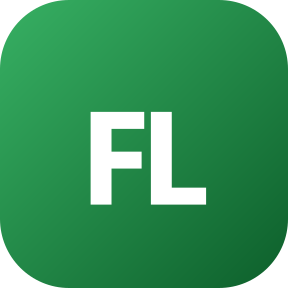
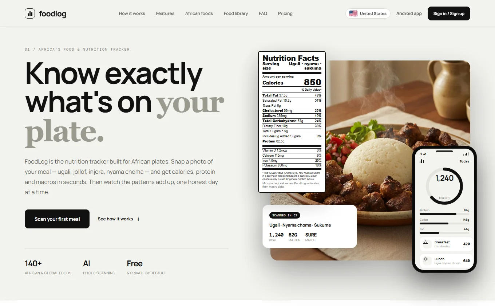
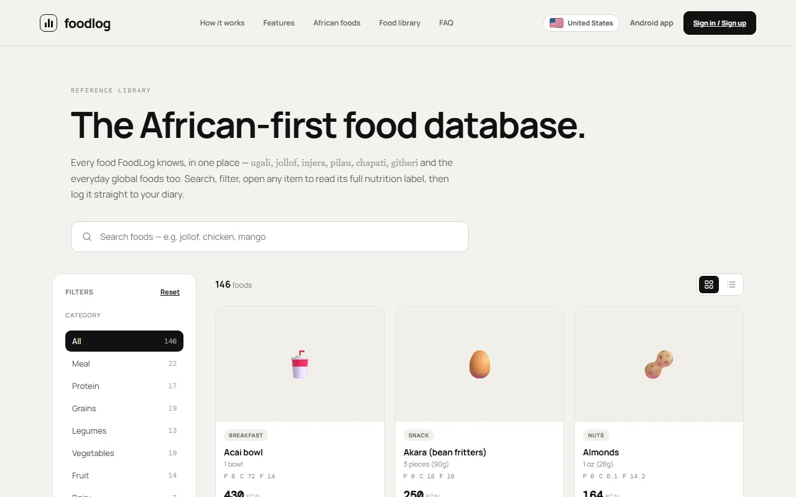
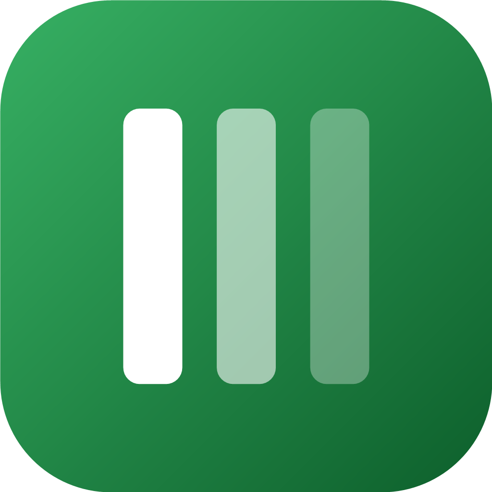

# FoodLog

*Know exactly what's on your plate.*

[Visit FoodLog](https://foodlog.xyz/) · [Repository guide](#repository-guide)

## Idea

A nutrition tracker built around African dishes, with photo and manual logging.

## Overview

FoodLog starts with the meals people actually eat. Its food library gives African dishes a place in nutrition tracking alongside familiar ingredients.

Users can log meals manually or use a photo to help identify what’s on the plate. The library is available to browse on the web.

## Screenshots

**[FoodLog homepage](https://foodlog.xyz/)**



**[Food library](https://foodlog.xyz/foods)**



## Repository guide

### Getting Started

First, run the development server:

```bash
npm run dev
# or
yarn dev
# or
pnpm dev
# or
bun dev
```

Open [http://localhost:3000](http://localhost:3000) with your browser to see the result.

You can start editing the page by modifying `app/page.tsx`. The page auto-updates as you edit the file.

This project uses [`next/font`](https://nextjs.org/docs/app/building-your-application/optimizing/fonts) to automatically optimize and load [Geist](https://vercel.com/font), a new font family for Vercel.

### Mobile App (React Native)



**FoodLog for Android** is a native mobile app built with **React Native (Expo)** -- log meals and track your daily nutrition, clearly.

**[Download the Android app](https://foodlog.xyz/downloads/foodlog.apk)**

- **Source:** [`foodlog-rn/`](foodlog-rn) -- the full Expo Router + TypeScript project.
- **Stack:** Expo SDK 57, Expo Router, TypeScript, React Native, AsyncStorage.
- Runs on Android 7.0+ (arm64 / armv7). You may need to allow *install from unknown sources*.

<br clear="left" />
